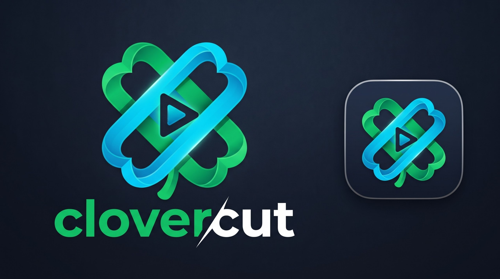
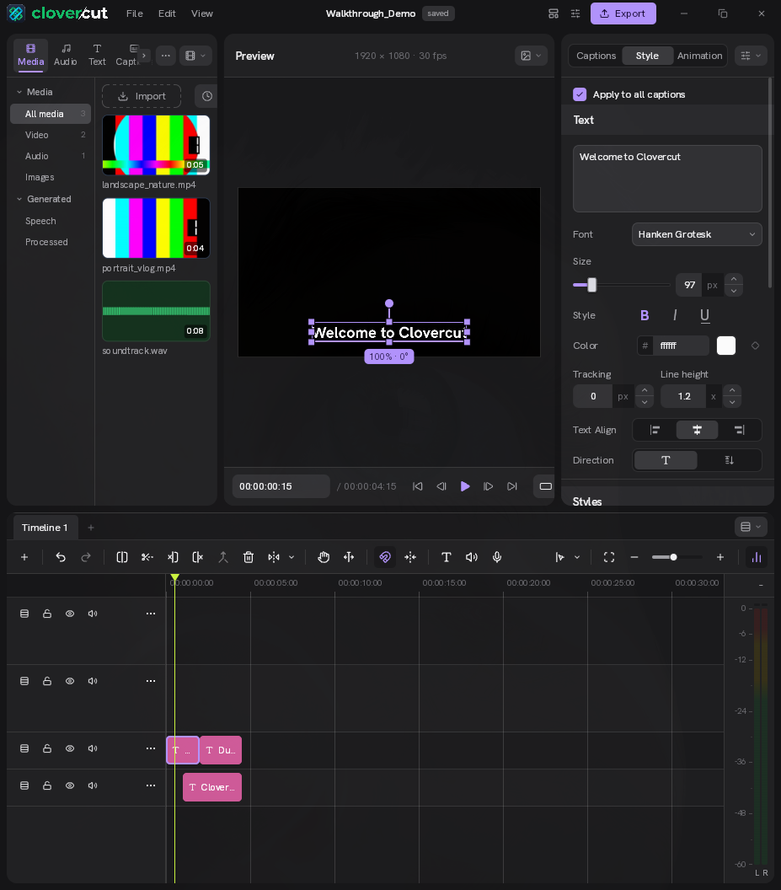
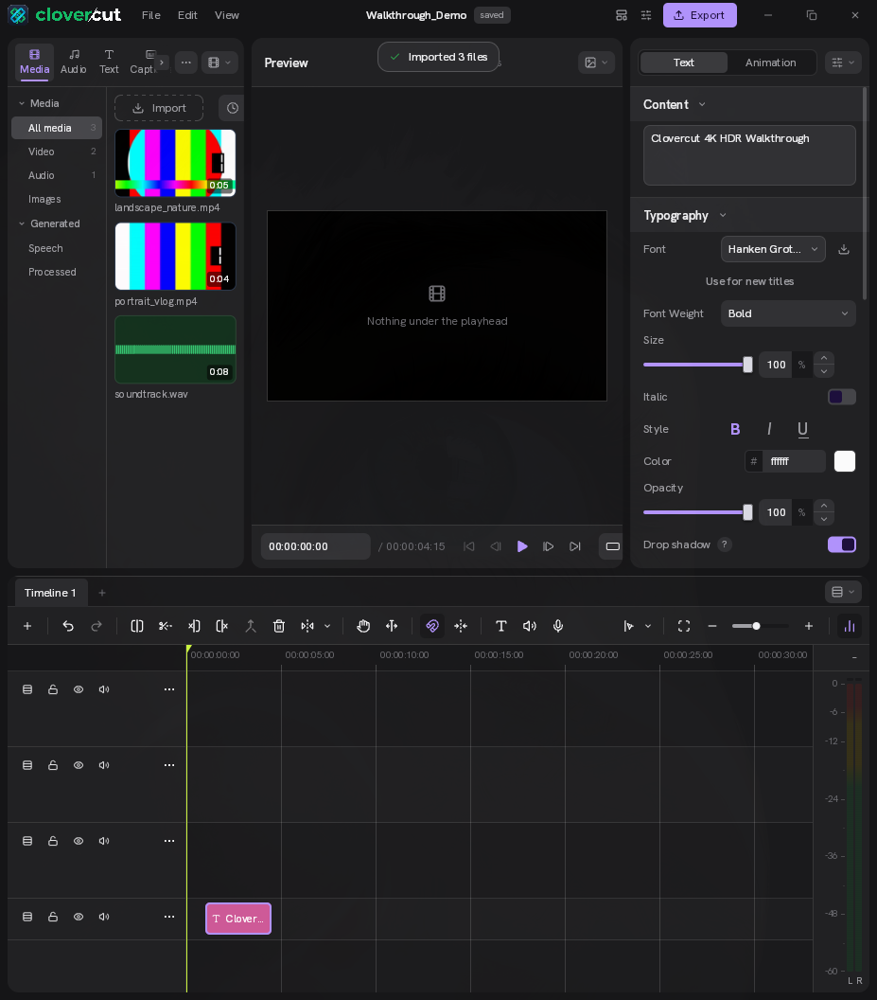
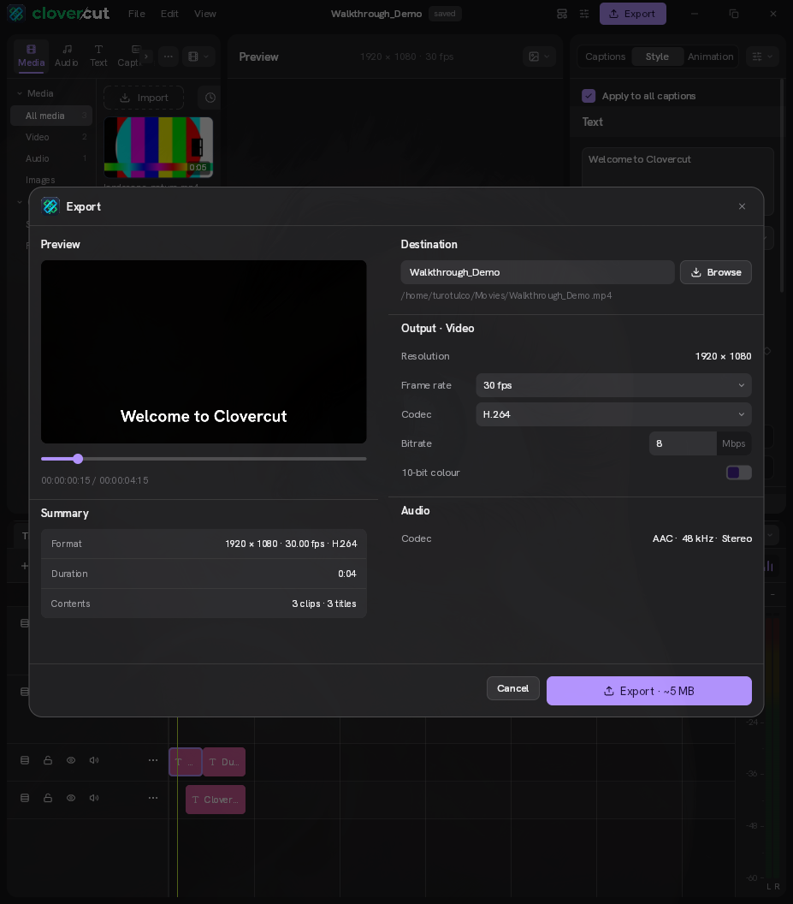
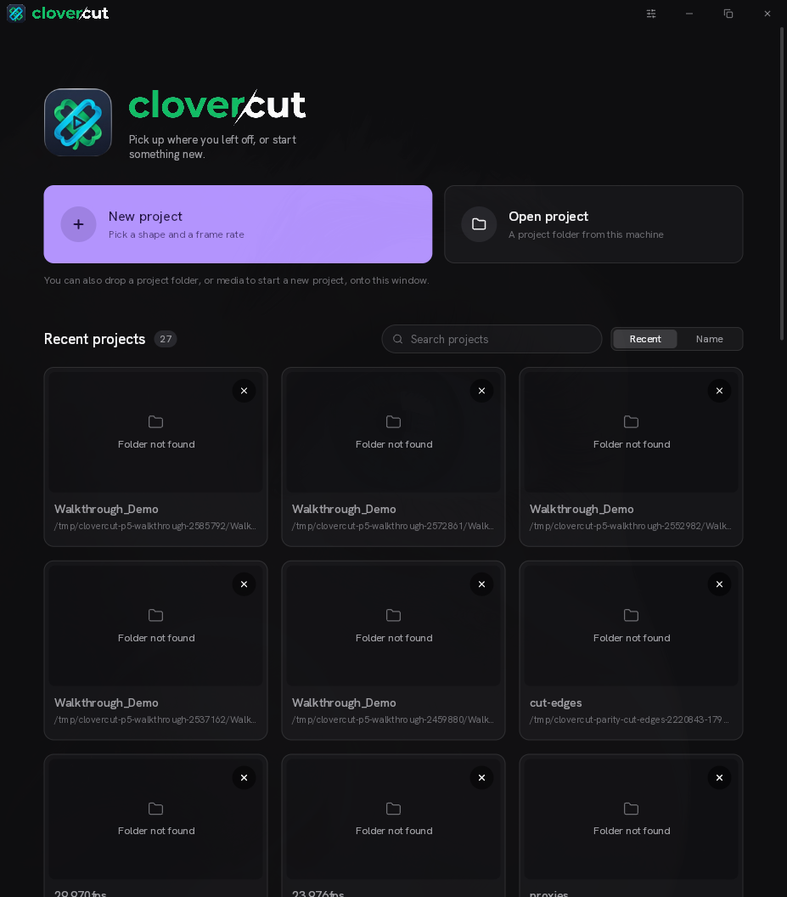

<p align="center">
  
</p>

<h1 align="center">Clovercut</h1>
<p align="center"><strong>Your video. Your machine. Your editor.</strong></p>
<p align="center">A fast, modern, local-first desktop video editor with GPU-accelerated composition and built-in AI tools.</p>

<p align="center">
  <a href="https://github.com/tulcoturo/clovercut"></a>
  <a href="https://github.com/tulcoturo/clovercut/releases"></a>
  <a href="https://github.com/tulcoturo/clovercut/issues"></a>
  <a href="LICENSE"></a>
  
</p>

---

## What is Clovercut?

**Clovercut** is a next-generation desktop video editor designed for creators who want the speed, intuitiveness, and workflow of modern editing suites (like CapCut) combined with the sovereignty of **100% local, offline processing**.

Built with a high-performance **Rust** engine and a responsive **Slint** interface, Clovercut gives you fluid timeline editing, professional subtitle styling, offline AI transcription, and integrated asset libraries without cloud paywalls, forced logins, telemetry, or artificial export locks.

<p align="center">
  
</p>
<p align="center"><em>Clovercut's 3-panel desktop workspace: Media bin & Content libraries (left), GPU Monitor (center), Contextual Inspector (right), and full-width precision multi-track timeline (bottom).</em></p>

---

## Why Clovercut? Core Standout Features

### 1. Modern, High-Productivity Workspace
- **CapCut-Inspired Desktop Layout:** A familiar 3-panel upper deck (Media & Effects, Playback Monitor, and Contextual Inspector) sitting on top of a full-width multi-track timeline.
- **Precision Timeline Tools:** Razor split tool, magnetic ripple editing, smooth logarithmic zoom slider, clip slip/trim, and clean track locking.
- **Keyframe Motion & Speed Ramps:** Enlarged, ringed keyframe markers on the ruler with direct Keyframes pane focus, plus non-destructive Bezier speed ramping curves.
- **Responsive Docking:** Adapts cleanly from full 4K and ultra-wide displays down to compact laptops and tiled window managers.

### 2. Dedicated Subtitle & Auto-Caption Engine
- **Local AI Auto-Captions:** Transcribe spoken audio directly to subtitles using bundled Whisper models — 100% offline on your own GPU/CPU, with zero data sent to external servers.
- **Dual Text Workflows:** Distinct, optimized tools for standalone titles/callouts vs. synchronized subtitle collections (`.srt`).
- **Rich Typography & Styling:** Comprehensive font picker, 0–20 px stroke outlines, drop shadows, background highlight boxes, and bold/italic/underline toggles.
- **Motion Presets:** One-click entrance and exit animation presets (**Fade**, **Slide**, **Pop**) with customizable duration.
- **Mixed-Script Vertical Text:** Native support for vertical text layout where East Asian (CJK) characters remain upright while Latin characters rotate sideways.
- **Reusable Subtitle Libraries:** Drag `.srt` files directly from the library to the timeline; collections are embedded into project files for complete portability.

<p align="center">
  
</p>
<p align="center"><em>Dedicated Subtitle Studio with batch styling, local sentence editing, animation presets, and live preview.</em></p>

### 3. Built-In Online & Offline Content Libraries
- **Animated Stickers (GIPHY Integration):** Search and preview trending animated stickers directly within the editor. Selected stickers are downloaded locally, copied into your project, and rendered with transparent WebM & GIF looping.
- **Sound Effects & Royalty-Free Music (OpenGameArt):** Browse CC0 sound effects and background tracks with instant audio preview, drag-and-drop timeline placement, and automatic offline caching.
- **4K Vector SVG Graphics:** Import `.svg` and `.svgz` vector assets directly as stills rendered up to 4K resolution via `resvg`.

### 4. Pro Color Grading & Visual Effects
- **3-Way Color Wheels & Curves:** Dedicated tabs for Lift, Gamma, Gain, RGB curves, saturation, and contrast.
- **3D LUT Support:** Import custom `.cube` lookup tables with intensity, bypass, and clip-level or adjustment-layer controls.
- **Drag-and-Drop Filters & Transitions:** Drop visual filters, color grades, and audio processors straight onto timeline clips or dedicated adjustment layers.

### 5. Private, Local-First Architecture
- **Zero Cloud Locks:** No subscriptions, no sign-ins, no watermarks, and no resolution throttles.
- **GPU Hardware Acceleration:** Real-time decoding and compositing powered by Vulkan (Linux) and Direct3D 12 (Windows), with automatic software fallback (`clovercut --software`) if graphics drivers misbehave.
- **Corruption-Proof Project Durability:** Atomic directory saves, unique snapshot tickets, and automatic crash recovery so your edits are never lost.

<p align="center">
  
</p>
<p align="center"><em>Centered, distraction-free Export dialog with video bitrate presets, audio stream control, frame preview, and file size estimation.</em></p>

---

## Interface Highlights

| Screen | Highlight |
| :--- | :--- |
| **Launch Hero** | <br>Clean start window with squircle branding, recent projects list, search, and instant project configuration. |
| **Export Modal** | <br>Customizable resolution (`1080p`, `4K`, `vertical 9:16`), frame rates (up to 60 fps), H.264/HEVC/AV1 encoding, and audio bitrates. |

---

## Downloads & Installation

Clovercut **0.0.2** binaries are packaged for **Linux** and **Windows (x64)**.

### Linux
Download the portable AppImage from [Releases](https://github.com/tulcoturo/clovercut/releases):

```bash
chmod +x Clovercut-0.0.2-x86_64.AppImage
./Clovercut-0.0.2-x86_64.AppImage
```

*(On systems without FUSE, run with `APPIMAGE_EXTRACT_AND_RUN=1`).*

### Windows (x64)
- **Installer:** Download `Clovercut-0.0.2-windows-x86_64-setup.exe` and follow the guided setup.
- **Portable:** Download `Clovercut-0.0.2-windows-x86_64-portable.zip`, extract to any directory, and run `clovercut.exe`.

### Safe Graphics Mode
If a GPU driver issue causes window corruption or crashes on startup:
```bash
clovercut --software
```
This forces software rasterization for the current run without permanently disabling your GPU.

---

## Building from Source

### Prerequisites
- **Rust 1.93.1+** (see [`src/rust-toolchain.toml`](src/rust-toolchain.toml)), with `rustfmt` and `clippy`.
- **FFmpeg 7+** development libraries (`libavcodec`, `libavformat`, `libavfilter`, `libswscale`, `libswresample`).
- **CMake**, a C++ compiler (`gcc`/`clang`), and `libclang`.
- **Linux system dependencies:** `fontconfig`, `freetype`, `alsa-lib`, `gtk3`, `libxkbcommon`.
- **ONNX Runtime & sherpa-onnx** (for local AI voice/speech models).

### Compiling
```bash
# Clone the repository
git clone https://github.com/tulcoturo/clovercut.git
cd clovercut

# Build and run the quick iteration profile (recommended)
cd src
cargo run --profile quick -p concat --bin clovercut
```

### Verification & Testing
```bash
# Format check
cargo fmt --manifest-path src/Cargo.toml --all --check

# Localization validation across 24 languages
python3 scripts/locales.py --check

# Core tests
cargo test -p concat-core -p concat-media -p concat-host
```

---

## Documentation & Resources

- [Keyboard Shortcuts](docs/KEYBOARD_SHORTCUTS.md) — Complete list of editing shortcuts and key bindings.
- [Audio & Content Libraries](docs/AUDIO_LIBRARY.md) — Guide to using OpenGameArt and GIPHY content.
- [Model Context Protocol (MCP)](docs/MCP.md) — Headless automation, CLI commands, and AI agent integration.
- [Translating Clovercut](TRANSLATING.md) — Help translate Clovercut into your language.
- [Contributing Guidelines](CONTRIBUTING.md) — Guidelines for code contributions, issue reports, and PRs.

---

## Credits & License

- Clovercut builds upon the native engine foundations established by **Jareer and Concat contributors**.
- Distributed under the **GNU Affero General Public License v3.0 or later** ([`LICENSE`](LICENSE)).
- Third-party dependencies and licensing notices are documented in [`THIRD_PARTY_NOTICES.md`](THIRD_PARTY_NOTICES.md).
