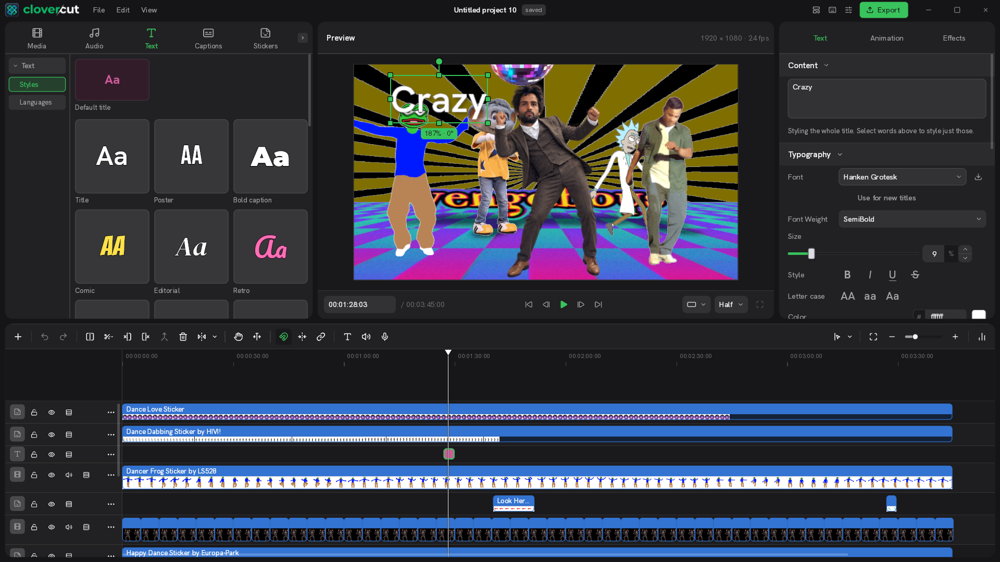
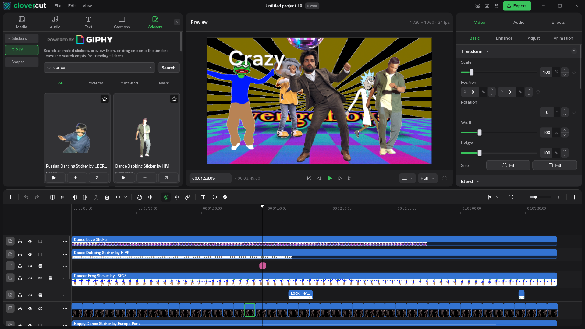
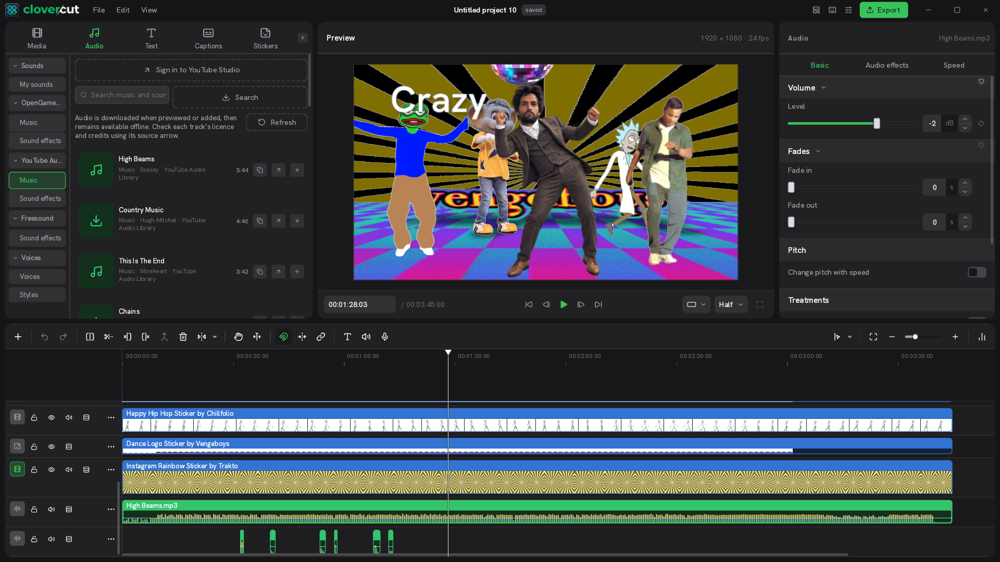

<p align="center">
  
</p>

<p align="center"><strong>Desktop-first, open-source video editor with built-in stock libraries and local AI.</strong></p>
<p align="center">A local-first creative workspace: on-device captions, searchable assets, reusable edits and watermark-free exports.</p>

<p align="center">
  <a href="https://tulcoturo.github.io/clovercut/"></a>
  <a href="https://github.com/tulcoturo/clovercut/releases/tag/v0.1.8"></a>
  <a href="https://github.com/tulcoturo/clovercut/issues"></a>
  <a href="LICENSE"></a>
  
</p>

<p align="center">
  🌐 <strong>Official Website:</strong> <a href="https://tulcoturo.github.io/clovercut/">https://tulcoturo.github.io/clovercut/</a>
</p>

---

## What is clovercut?

**clovercut** is a desktop-first video editor for Linux, Windows and macOS, designed for creators who want the intuitive, fast workflow of tools like CapCut without cloud lock-ins, paid subscription tiers, watermarks, or telemetry.

The editing workflow is centred on a desktop computer: keyboard and mouse, a multi-track timeline, and a full-size preview and inspector. Desktop use drives development and release priorities. Mobile support is secondary and may have a different feature set and release schedule.

Built with a native **Rust** core and a **Slint** interface accelerated by WGSL GPU compute shaders, editing and local AI run on your own machine. Optional online libraries connect to their respective providers.

<p align="center">
  
</p>
<p align="center"><em>clovercut multi-track workspace: Media & creative tools (left), 4K GPU monitor (center), contextual inspector (right), and magnetic timeline (bottom).</em></p>

---

## What sets clovercut apart?

Clovercut combines a familiar desktop editing workflow with creative libraries and local AI. Its strengths are the combination of tools and the control you retain over your projects:

| What matters in your workflow | What Clovercut offers |
|---|---|
| Keep recordings on your computer | Local editing and Whisper transcription after model download |
| Find assets while editing | Searchable audio and GIPHY libraries, previews and timeline import |
| Reuse a finished look | Clip copy/paste between projects, grouped duplication and adjustment layers |
| Reach familiar tools quickly | Favourites, recent and most-used assets, hover transition previews |
| Work on a desktop | Multiple timelines, compact tracks, keyboard shortcuts and an adaptive inspector |
| Keep control of the editor | AGPL source code and exports without a Clovercut watermark or subscription |

Online assets retain their own licences and availability.

### 1. On-Device Whisper AI Captions
* **100% Offline Speech-to-Text:** Generates synchronized subtitles using OpenAI Whisper running directly on your CPU/GPU.
* **Complete Privacy:** Your recordings and voice clips are never uploaded to any remote server.
* **Full Styling & Export:** Customize fonts (Hanken Grotesk, Roboto, etc.), outline strokes, shadows, background boxes, and export clean `.srt` subtitle files.

<p align="center">
  
</p>

### 2. Integrated GIPHY Animated Stickers
* **Direct In-App Search:** Search millions of transparent animated stickers and memes powered by GIPHY without switching windows.
* **Instant Timeline Drop:** Drag any sticker straight onto an overlay video track.

<p align="center">
  
</p>

### 3. Music & Sound Effects Inside the Workspace
* **Public Domain / CC0 Music:** Integrated OpenGameArt music and sound effects library.
* **Waveform Previews:** Listen to tracks and view waveforms directly inside the media bin before placing them on audio tracks.
* **More Sources:** Freesound previews and separate YouTube music/sound-effect sections, with per-track licences and copyable credits. Freesound requires an API key.
* **Local YouTube sign-in:** Clovercut starts the bundled [Audio API connector](https://github.com/tulcoturo/clovercut-audio-api) on demand and opens a dedicated browser for Studio sign-in. The saved session is reused in the background; no VPS is needed. Chrome, Chromium or Edge must be installed. See [audio setup](docs/AUDIO_LIBRARY.md).

<p align="center">
  
</p>

### 4. CapCut-Style Workflow with Native Rust Speed
* **Single-Track Playhead Razor (`Ctrl+B`):** Split clips on the active track with a single keypress without slicing through your whole timeline.
* **Strict Adjustment Layers:** Color grades and visual effects stay strictly bounded above the main video lane.
* **Personal Libraries:** Star effects, filters, transitions and stickers; browse favourites, most-used and recent items.
* **Online GL Transitions:** Download 123 supported transitions on demand and preview them by hovering over their cards.
* **Real-Time GPU Transitions:** WGSL compute shaders powering transitions (Barn Door, Circle Close, Cover, Wipe, Pixelize, Glitch) with 1:1 preview cards.
* **Clean 4K Export:** Export high-bitrate MP4 (H.264), ProRes, and AV1 up to 60 FPS without watermarks.

<p align="center">
  
</p>

---

## New in 0.1.8

Style individual words, link ripple edits across tracks and apply audio effects to the whole soundtrack. Set a canvas colour or export transparency with ProRes 4444/MOV and VP9/WebM. This release also improves preview selection, allows generated clips to extend left, fixes Studio previews across interface languages and simplifies the Text library. Revised default track heights and distinct colours help separate track types at a glance. [Read the full release notes](docs/releases/0.1.8.md).

## Downloads (Version 0.1.8)

The desktop packages are available on [GitHub Releases](https://github.com/tulcoturo/clovercut/releases/tag/v0.1.8):

| Platform | Package | Architecture | Format |
|---|---|---|---|
| **Linux** | [Download AppImage](https://github.com/tulcoturo/clovercut/releases/download/v0.1.8/Clovercut-0.1.8-x86_64.AppImage) | x86_64 | Portable `.AppImage` |
| **Linux (ARM)** | [Download AppImage](https://github.com/tulcoturo/clovercut/releases/download/v0.1.8/Clovercut-0.1.8-aarch64.AppImage) | aarch64 | Portable `.AppImage` |
| **Windows** | [Download Setup Installer](https://github.com/tulcoturo/clovercut/releases/download/v0.1.8/Clovercut-0.1.8-windows-x86_64-setup.exe) | x86_64 | Guided `.exe` installer |
| **Windows** | [Download Portable Zip](https://github.com/tulcoturo/clovercut/releases/download/v0.1.8/Clovercut-0.1.8-windows-x86_64-portable.zip) | x86_64 | Standalone `.zip` |
| **Windows (ARM)** | [Download Setup Installer](https://github.com/tulcoturo/clovercut/releases/download/v0.1.8/Clovercut-0.1.8-windows-aarch64-setup.exe) | aarch64 | Native `.exe` installer |
| **Windows (ARM)** | [Download Portable Zip](https://github.com/tulcoturo/clovercut/releases/download/v0.1.8/Clovercut-0.1.8-windows-aarch64-portable.zip) | aarch64 | Standalone `.zip` |
| **macOS (Apple Silicon)** | [Download DMG](https://github.com/tulcoturo/clovercut/releases/download/v0.1.8/Clovercut-0.1.8-macos-arm64.dmg) | arm64 | `.dmg` disk image |
| **macOS (Intel)** | [Download DMG](https://github.com/tulcoturo/clovercut/releases/download/v0.1.8/Clovercut-0.1.8-macos-x86_64.dmg) | x86_64 | `.dmg` disk image |

Desktop is the primary supported workflow. Version 0.1.8 is desktop-only; mobile builds follow a separate schedule. The previous [Android 0.1.3 APK](https://github.com/tulcoturo/clovercut/releases/download/v0.1.3/Clovercut-0.1.3-android-arm64.apk) remains available.

Native `.deb` and `.rpm` packages are built by CI from the next release on. Until then, Linux installs go through the AppImage, the one-line installer below, or the AUR.

### Install on Linux
One-line install (picks the native package for your distro, falls back to the AppImage):
```bash
curl -fsSL https://raw.githubusercontent.com/tulcoturo/clovercut/main/scripts/install.sh | sh
```

By distro, once native packages are published for your version (`X.Y.Z`):
```bash
# Debian / Ubuntu / Mint / Pop!_OS
curl -fsSLO https://github.com/tulcoturo/clovercut/releases/download/vX.Y.Z/Clovercut-X.Y.Z-x86_64.deb
sudo apt install ./Clovercut-X.Y.Z-x86_64.deb

# Fedora / RHEL / openSUSE
curl -fsSLO https://github.com/tulcoturo/clovercut/releases/download/vX.Y.Z/Clovercut-X.Y.Z-x86_64.rpm
sudo dnf install ./Clovercut-X.Y.Z-x86_64.rpm

# Arch / CachyOS / Manjaro / EndeavourOS (prebuilt AppImage repackaged)
yay -S clovercut-bin
# or: paru -S clovercut-bin
```

Packagers: `scripts/build-deb.sh` and `scripts/build-rpm.sh` build both formats from the staged Linux folder with only `dpkg-deb` / `rpmbuild` (`assets/linux/nfpm.yaml` keeps the equivalent nfpm description for CI). The AUR package lives in `assets/arch/` (`PKGBUILD` + `.SRCINFO`, package name `clovercut-bin`).

### Running on Linux
```bash
chmod +x Clovercut-0.1.8-x86_64.AppImage
./Clovercut-0.1.8-x86_64.AppImage
```

*(On systems without FUSE installed, launch with `APPIMAGE_EXTRACT_AND_RUN=1`).*

### Safe Graphics Fallback
If graphics drivers cause startup issues:
```bash
clovercut --software
```
This forces software rasterization for the session without altering your system GPU settings.

---

## Building from Source

### Prerequisites
* **Rust 1.93.1** (see [`src/rust-toolchain.toml`](src/rust-toolchain.toml))
* **FFmpeg 7+** development libraries (`libavcodec`, `libavformat`, `libavfilter`, `libswscale`, `libswresample`)
* **CMake**, C++ compiler (`gcc`/`clang`), and `libclang`
* **Linux libraries:** `fontconfig`, `freetype`, `alsa-lib`, `gtk3`, `libxkbcommon`
* **ONNX Runtime & sherpa-onnx** (for local Whisper and speech models)

### Compiling
```bash
# Clone the repository
git clone https://github.com/tulcoturo/clovercut.git
cd clovercut

# Build and run with the quick development profile
cd src
cargo run --profile quick -p concat --bin clovercut -j1
```

*(Using `-j1` limits memory consumption on systems with 16 GB RAM).*

### Running Verification Tests
```bash
# Check formatting
cargo fmt --manifest-path src/Cargo.toml --all --check

# Check localization across all 24 languages
python3 scripts/locales.py --check

# Run engine core tests
cargo test --manifest-path src/Cargo.toml -p concat-core -p concat-media -p concat-host -j1
```

---

## Documentation

* [Documentation](docs/README.md): Editing, content libraries, automation and release guides.
* [Keyboard Shortcuts](docs/KEYBOARD_SHORTCUTS.md): List of editing shortcuts and key bindings.
* [Audio & Content Libraries](docs/AUDIO_LIBRARY.md): Guide to OpenGameArt, YouTube Audio Library, Freesound and GIPHY.
* [Model Context Protocol (MCP)](docs/MCP.md): Headless automation, CLI tools, and AI agent integration.
* [Release Notes v0.1.8](docs/releases/0.1.8.md): Complete changelog for version 0.1.8.
* [Translating clovercut](TRANSLATING.md): Guide to contributing translations across all 25 supported languages.

---

## License & Acknowledgements

* clovercut builds upon engine foundations established by **Jareer and Concat contributors**.
* Distributed under the **GNU Affero General Public License v3.0 or later** ([`LICENSE`](LICENSE)).
* Third-party licenses and notices are documented in [`THIRD_PARTY_NOTICES.md`](THIRD_PARTY_NOTICES.md).
